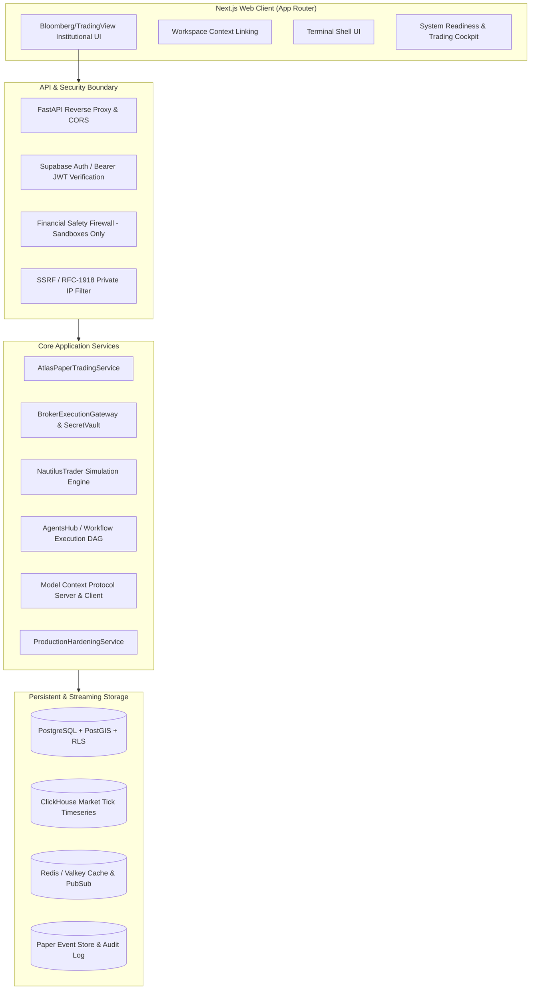

# ATLAS — Final Platform Architecture

**ATLAS: AI-Native Financial Intelligence & Quantitative Research Operating System**  
**Milestone:** Complete 150-Stage Platform Architecture  
**Status:** Integrated & Production Hardened  

---

## 1. Executive Summary

ATLAS is an institutional-grade, AI-native financial intelligence platform uniting global market analytics, multi-asset quantitative modeling, geospatial intelligence, interactive financial charting, sandboxed scripting shells, durable autonomous agent orchestration, and extensible developer ecosystems.

All 150 roadmap stages have been engineered into a unified, modular monorepo spanning:
1. **Frontend:** Next.js (App Router), React, TypeScript, Tailwind CSS, Lucide icons, Cesium/MapLibre geospatial renderers, and Canvas/SVG quantitative visualizers.
2. **Backend:** Python 3.12+, FastAPI, NautilusTrader event-driven backtesting and paper simulation engines, QuantLib options pricing analytics, PyTorch/TensorFlow ML pipelines, and Celery/Redis durable execution workers.
3. **Storage & Data:** PostgreSQL with Supabase Row-Level Security (RLS), PostGIS for geospatial vectors, ClickHouse for sub-millisecond tick timeseries, and Redis/Valkey for low-latency session and pub/sub caching.
4. **Safety & Governance:** Absolute Financial Safety Firewall enforcing strictly simulated paper trading and isolated broker sandboxes with zero live capital exposure.

---

## 2. Canonical Module Topology (All 20 Modules)

ATLAS exposes 20 deeply integrated modules with bidirectional workspace linking:

```mermaid
graph TD
    classDef core fill:#1e1e24,stroke:#6366f1,stroke-width:2px,color:#fff;
    classDef trading fill:#182825,stroke:#10b981,stroke-width:2px,color:#fff;
    classDef ai fill:#2a1e2d,stroke:#ec4899,stroke-width:2px,color:#fff;
    classDef geo fill:#1e2638,stroke:#06b6d4,stroke-width:2px,color:#fff;

    Home[1. Home & Global Overview]:::core
    Markets[2. Multi-Asset Markets]:::core
    Watchlist[3. Real-Time Watchlists]:::core
    Screener[4. Multi-Factor Screeners]:::core
    Companies[5. Fundamental Company Intelligence]:::core
    Economics[6. Macroeconomic & Central Bank]:::core
    News[7. Semantic News & Sentiment]:::core
    Research[8. Grounded Research & Thesis Studio]:::core
    Options[9. QuantLib Options Strategy Engine]:::core
    Portfolios[10. Portfolio Valuation & Accounting]:::core
    Risk[11. VaR & Scenario Stress Testing]:::core
    Maps[12. PostGIS Geospatial Supply Chains]:::geo
    Globe[13. 3D Global Infrastructure Intelligence]:::geo
    Terminal[14. Sandboxed Terminal Shell & SQL]:::core
    AI[15. AI Assistant & Universal Overlay]:::ai
    Workspaces[16. Bloomberg-Style Dynamic Workspaces]:::core
    Backtest[17. NautilusTrader Backtesting Lab]:::trading
    Paper[18. Paper Trading & Liquidity Sandbox]:::trading
    Brokers[19. Broker Abstraction & Sandbox Gateways]:::trading
    Agents[20. Autonomous Multi-Agent & MCP Ecosystem]:::ai

    Home --> Markets & Watchlist & Screener & News
    Markets --> Companies & Economics & Options
    Companies --> Portfolios & Research & Risk
    Terminal --> Backtest & Paper & Brokers
    AI --> Research & Agents
    Workspaces --> Backtest & Paper & Globe & Maps
```

---

## 3. High-Level System Architecture

---

## 4. Financial Safety Firewall Specification

ATLAS enforces an immutable **Financial Safety Firewall** across all engines:
1. **Categorical Prohibition of Real-Money Broker Trading:** Real broker order endpoints are intercepted and blocked at the router layer (`LiveBrokerBlockedError`).
2. **Deterministic Sandbox Adapters:** External broker adapters (`ALPACA_PAPER`, `UPSTOX_SANDBOX`, `TRADIER_SANDBOX`) connect exclusively to sandbox subdomains (`paper-api.alpaca.markets`, `api-sandbox.upstox.com`, `sandbox.tradier.com`). Any host mismatch triggers `SandboxFirewallError`.
3. **Account Isolation & Kill Switches:** Virtual paper accounts maintain dedicated balances, equity, margin, and order books. The Emergency Kill Switch can be tripped manually or automatically by risk policy thresholds, freezing order flows without data loss.

---

## 5. Security & Isolation Architecture

1. **Multi-Tenant Isolation:** All database schemas, agent workflows, paper accounts, and broker connections enforce strict PostgreSQL Row-Level Security (RLS) and programmatic `tenant_id` validation. Cross-tenant access raises `CrossTenantAccessError` (HTTP 403).
2. **Encrypted Credential Vaulting:** Broker sandbox secrets and API tokens are encrypted in-memory using symmetric Fernet encryption (`SecretVault`). Raw credentials are never serialized in API responses or persisted in logs.
3. **SSRF Defense:** All external webhook, HTTP trigger, and MCP server URLs are inspected against loopback, private subnets (RFC 1918), and cloud metadata endpoints (`169.254.169.254`).
4. **Supply-Chain & Package Protection:** Ingested `.atlas-agent` packages are validated against Zip-Slip path traversals, decompression bombs, and exposed API keys.

---

## 6. Conclusion

The ATLAS platform architecture provides a complete, hardened, institutional-grade foundation capable of serving quantitative hedge funds, research analysts, and enterprise multi-agent workflows with zero compromise on safety, reliability, and precision.
