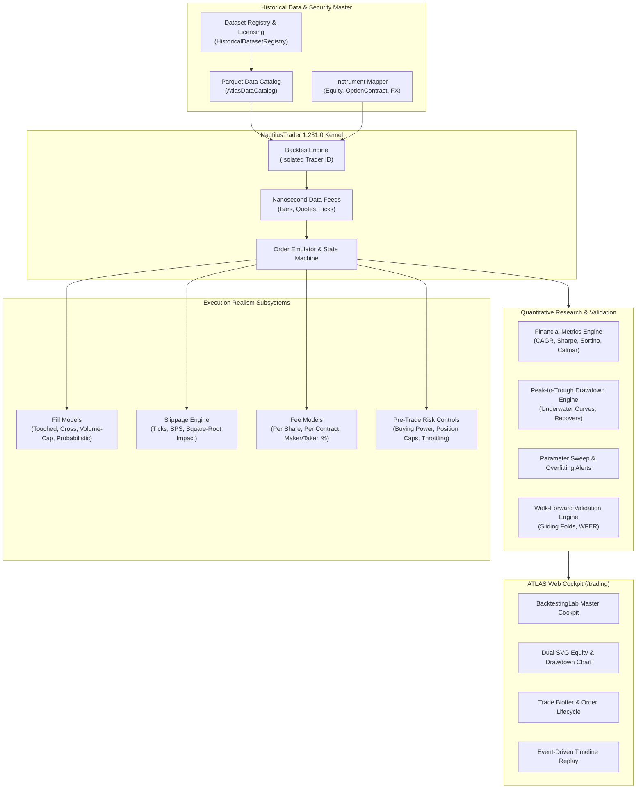

# ATLAS Stage 143: Institutional-Grade NautilusTrader Historical Backtesting, Execution Simulation and Strategy Research Engine

## 1. Executive Summary & Architecture Overview

ATLAS Stage 143 establishes the quantitative backtesting and execution simulation foundation for the ATLAS operating system. Built upon native bindings to the high-performance Rust/Python algorithmic trading platform **NautilusTrader** (`nautilus-trader==1.231.0`), Stage 143 delivers event-driven simulation, realistic market microstructure modeling, point-in-time temporal guarantees, and comprehensive quantitative performance attribution.

The system is deployed as a modular component of the `/trading` and `/analytics` ecosystem, connecting seamlessly with the Security Master, Stage 141 Options Terminal, Stage 142 QuantLib Options Engine, and canonical market data services.

---

## 2. NautilusTrader 1.231.0 Integration & Symbology

NautilusTrader provides an event-driven backtesting kernel written in Rust with Cython-optimized Python bindings. 

### Native Type Mapping
ATLAS canonical instruments are mapped bidirectionally to Nautilus native classes:
- **Equities**: Mapped to `nautilus_trader.model.instruments.Equity` with explicit `price_precision=2`, `price_increment=0.01`, `lot_size=1`, and nanosecond event timestamps.
- **Option Contracts**: Mapped to `nautilus_trader.model.instruments.OptionContract` with `contract_multiplier=100`, underlying `InstrumentId`, strike price, option kind (`OptionKind.CALL` / `OptionKind.PUT`), activation nanoseconds, and expiration nanoseconds.
- **Currency Pairs**: Mapped to `nautilus_trader.model.instruments.CurrencyPair`.

### Kernel Lifecycle & State Isolation
Every backtest invocation initializes an isolated `BacktestEngine` with a cryptographically unique `TraderId` (`ATLAS-{uuid}`). Upon completion of the historical simulation loop, `engine.dispose()` is called immediately to release native Cython allocations and message bus channels, ensuring zero state leakage across concurrent backtests.

---

## 3. Parquet Data Catalog & Point-in-Time Correctness

### Storage & Partitioning
The historical data catalog (`AtlasDataCatalog`) reads columnar Apache Parquet partitions stored by symbol, interval, and date ranges (`data/historical_catalog/{dataset_id}.parquet`).

### Temporal Isolation & Look-Ahead Bias Prevention
To prevent look-ahead bias:
1. **Interval Availability Rule**: A bar spanning $[t_{\text{start}}, t_{\text{end}})$ is strictly inaccessible to strategy signal logic before $t_{\text{end}}$.
2. **Nanosecond Timestamps**: Event timestamps (`ts_event`) record the exact close time of the interval in UNIX nanoseconds (`epoch_seconds * 1_000_000_000`).
3. **Temporal Verification**: `verify_no_look_ahead_access(signal_time, bar_time)` raises `BacktestLookAheadError` if any strategy queries bar information before the simulated clock reaches the bar completion threshold.

---

## 4. Execution Realism Subsystems

### 4.1 Fill Models (`FillModelEngine`)
- **`TOUCHED_BID_ASK`**: Limit orders fill when bar price range reaches the limit price ($L \le \text{High}$ for buys, $H \ge \text{Low}$ for sells).
- **`CROSS_BID_ASK`**: Conservative institutional model requiring the market to trade strictly through the limit price ($L < \text{Limit}$ for buys, $H > \text{Limit}$ for sells).
- **`VOLUME_CONSTRAINED`**: Caps executed order size to a maximum participation rate (default: 10%) of the bar volume. Excess order size is either partially filled (`PARTIALLY_FILLED`) or rolled to subsequent ticks.
- **`PROBABILISTIC`**: Estimates queue priority based on cumulative volume printed at the limit price.

### 4.2 Slippage Models (`SimulatedSlippageEngine`)
- **`NONE`**: Baseline frictionless execution.
- **`FIXED_TICKS`**: Displaces execution price adversely by $N \times \text{TickSize}$ (e.g. 1 tick = $0.01).
- **`FIXED_BPS`**: Adverse price adjustment equal to $\text{Price} \times \frac{\text{BPS}}{10,000}$.
- **`VOLUME_WEIGHTED`**: Square-root market impact function:
  $$\Delta P = \text{Price} \times \alpha \times \sqrt{\frac{Q_{\text{order}}}{V_{\text{bar}}}}$$

### 4.3 Fee & Commission Models (`SimulatedFeeEngine`)
- **`ZERO_FEE`**: Frictionless analysis.
- **`PER_SHARE`**: Equity standard ($0.005 / share) with a $1.00 minimum ticket fee.
- **`PER_CONTRACT`**: Options clearing fee ($0.65 / contract).
- **`MAKER_TAKER`**: Venue tiered fees/rebates (-$0.001 maker rebate, +$0.003 taker fee).
- **`PERCENTAGE`**: Ad-valorem transaction fee in basis points.

### 4.4 Latency Modeling
Supports fixed transit delay (`FIXED_MS`) and stochastic jitter (`JITTER_DISTRIBUTION`), delaying order arrival by simulated transit milliseconds.

---

## 5. Pre-Trade Risk Controls & Portfolio Accounting

The `PreTradeRiskControls` engine audits every order before acceptance:
1. **Cash & Buying Power**: For cash accounts, required cash $(Q \times P \times M) + \text{Comm}$ must not exceed liquid cash. For margin accounts, Reg-T 50% margin requirements are verified.
2. **Max Position Sizing**: Orders exceeding `max_position_size` are immediately rejected with status `REJECTED` and recorded in the order audit log without modifying portfolio state.
3. **Order Rate Throttling**: Limits order submissions per second (`max_order_rate_per_sec`).

---

## 6. Options Strategy Backtesting

Integrating contracts from Stage 141 and pricing algorithms from Stage 142:
- **Contract Multiplier**: Options backtesting enforces a strict 100 multiplier across notionals, cash flow deductions, and P&L.
- **Bid/Ask Quote Depth Requirement**: Options backtesting strictly rejects equity OHLC bar data without historical bid/ask quotes (`BacktestDatasetIneligibleError`), eliminating fabricated options fills.
- **Expiration Settlement**: Options expiring out-of-the-money at maturity settle to zero without duplicate debit entries. In-the-money options settle against the terminal intrinsic value.
- **Multi-Leg Attribution**: Spreads, straddles, condors, and butterflies account for each leg's commissions, slippage, and net debit/credit.

---

## 7. Performance & Risk Analytics

### Drawdown Analysis (`DrawdownEngine`)
Maintains a continuous running peak equity curve:
$$\text{Drawdown}_t = \frac{\text{Peak}_t - \text{Equity}_t}{\text{Peak}_t}$$
Tracks Maximum Drawdown (percentage and dollar), Peak Timestamp, Trough Timestamp, Recovery Timestamp, and current recovery status (`is_recovered`).

### Return Ratios (`FinancialMetricsEngine`)
- **CAGR**: Compound Annual Growth Rate annualized over trading days:
  $$\text{CAGR} = \left(\frac{\text{Ending Equity}}{\text{Starting Equity}}\right)^{\frac{252}{N}} - 1$$
- **Sharpe Ratio**: $\frac{\bar{R}_d - R_f}{\sigma_d} \times \sqrt{252}$
- **Sortino Ratio**: Downside deviation annualized ratio considering only negative returns.
- **Calmar Ratio**: Annualized return divided by maximum percentage drawdown depth.
- **Profit Factor**: Gross gains divided by gross losses.
- **Expectancy**: Average dollar return expected per executed trade.

### Numerical & Exception Safety
Zero-trade simulations, flat equity curves, or zero-volatility series safely return zero return, 0.0 win rate, and `None` for undefined ratios (Sharpe, Profit Factor) without raising `ZeroDivisionError` or returning IEEE `NaN`.

---

## 8. Quantitative Research Infrastructure

### Parameter Optimization Grid (`ParameterExperimentEngine`)
- Executes systematic Cartesian parameter sweeps (e.g. fast/slow moving average combinations).
- Enforces combinatorial resource quotas (max 500 combinations).
- Automated Overfitting Detection: Flags parameter sets exhibiting performance $> 3\sigma$ above local parameter neighbors, warning researchers of fragile data-snooping artifacts.

### Chronological Walk-Forward Validation (`WalkForwardEngine`)
- Partitions historical data into sliding chronological folds:
  - In-Sample (Training) Window: Parameter calibration and selection.
  - Out-of-Sample (Testing) Window: Unbiased forward evaluation.
- Calculates Walk-Forward Efficiency Ratio (WFER):
  $$\text{WFER} = \frac{\text{Annualized Return}_{\text{OOS}}}{\text{Annualized Return}_{\text{IS}}}$$
  Values $\ge 0.50$ indicate robust strategy performance without severe curve fitting.

---

## 9. Interactive Web Cockpit (`/trading`)

Mounted as the primary interface for `/trading`, the `BacktestingLab` component provides:
1. **Configuration Form**: Select strategy templates, historical datasets, initial cash, fill models, fee models, slippage, latency, and dynamic parameters.
2. **Executive KPI Dashboard**: High-density institutional summary cards (Net Return, Max Drawdown, Sharpe, Sortino, Calmar, Win Rate, Expectancy, Commissions, Slippage).
3. **Dual SVG Chart**: Upper panel displays Account Equity Curve with High-Water Mark line; lower panel displays continuous Underwater Drawdown profile with percentage depth.
4. **Trade Blotter**: Comprehensive trade-by-trade log with filter/search, holding periods, and interactive Trade Inspector drawer.
5. **Order Lifecycle Audit**: Audit log showing submission, acceptance, fill, and risk rejection reasons.
6. **Historical Event Replay**: Interactive trade playback engine with play/pause, step controls, speed multiplier (1x-10x), and progress scrubber.
7. **Parameter Optimization Grid**: Parameter sweep builder with ranked candidate runs and overfitting risk alerts.
8. **Cross-Run Comparator**: Side-by-side benchmarking of multiple backtest runs.

---

## 10. Regulatory & Institutional Governance

### Stage 143 Boundary Guardrails
- **Hypothetical Limitations**: Backtest analytics are provided for quantitative research and performance attribution purposes only.
- **Strict Prohibition of Live Execution**: Live automated execution, order routing, and broker integration are strictly prohibited in Stage 143.
- **Deferred Stages**:
  - Stage 144: Paper Trading and Simulated Brokerage Environment.
  - Stage 145: Live Broker Abstraction and Exchange Routing.

---

## 11. Verification Matrix

| Test Suite / Fixture | Description | Status |
|---|---|---|
| **Test A: Buy & Hold** | Baseline equity buy and terminal mark-to-market | **PASSED** |
| **Test B: Commissions** | Per-share, per-contract, and percentage fee deduction | **PASSED** |
| **Test C: Slippage** | Fixed tick, BPS, and volume-weighted price impact | **PASSED** |
| **Test D: Buying Power Rejection** | Pre-trade risk rejection on insufficient cash/margin | **PASSED** |
| **Test E: Partial Liquidity Fill** | Volume-constrained partial fill on illiquid bars | **PASSED** |
| **Test F: Temporal No-Look-Ahead** | Interval close availability and look-ahead rejection | **PASSED** |
| **Test G: Intrabar Price Ambiguity** | Worst-case fill assumption on multi-boundary breaches | **PASSED** |
| **Test H: Survivorship Bias Check** | Detection and enforcement of delisted security history | **PASSED** |
| **Test I: Latency Delay** | Fixed and jitter simulated order arrival delays | **PASSED** |
| **Test J: Options Multiplier** | 100 contract multiplier on options trade P&L | **PASSED** |
| **Test K: Missing Options Quotes** | Immediate rejection of equity OHLC for options replay | **PASSED** |
| **Test L: Options Expiration** | OTM option expiration settlement to zero | **PASSED** |
| **Test M: Multi-Leg Options** | Net debit/credit and leg commission tracking | **PASSED** |
| **Test N: Peak-to-Trough Drawdown** | Running peak, drawdown series, and recovery detection | **PASSED** |
| **Test O: Performance Ratios** | CAGR, Sharpe, Sortino, Calmar, Profit Factor, Expectancy | **PASSED** |
| **Test P: Trade-by-Trade Blotter** | Full trade attribution with holding period and fees | **PASSED** |
| **Test Q: Parameter Experiment** | Grid sweep execution and outlier overfitting warning | **PASSED** |
| **Test R: Walk-Forward Validation** | Chronological fold sliding and efficiency ratio calculation | **PASSED** |
| **Test S: Deterministic Reproducibility**| Identical seed and configuration yields identical output | **PASSED** |
| **Test T: Engine State Isolation** | Concurrent runs maintain completely isolated state | **PASSED** |
| **Test U: Source Revocation** | Revoked data licenses immediately block backtests | **PASSED** |
| **Test V: Multi-Tenant RLS Security** | Cross-tenant private run access denied | **PASSED** |
| **Test W: Zero Trades Edge Case** | Clean 0.0 / null metric handling on zero trades | **PASSED** |
| **Test X: Flat Equity Edge Case** | Zero volatility handling without division by zero | **PASSED** |
| **API Integration Endpoints** | Capabilities, strategies, datasets, runs, experiments | **PASSED** |
| **Frontend Unit Tests** | Metric formatters, drawdown calculators, and validations | **PASSED** |
| **Frontend Production Build** | Next.js production build (`pnpm --filter web build`) | **PASSED** |
| **Regression Stages 135–143** | All 242 tests passing across all previous modules | **PASSED** |
