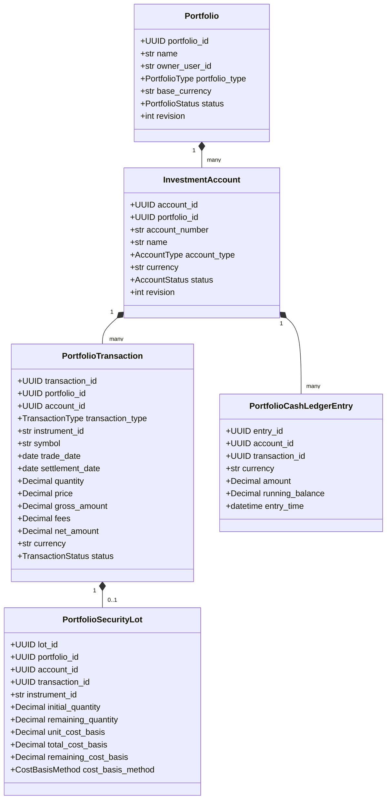

# PORTFOLIOS V1: Institutional-Grade Portfolio Management Foundation, Accounting & Valuation Architecture

**Canonical Roadmap:** Stage 110 of 150  
**Primary Module:** Portfolios  
**Primary Route:** `/portfolios`  
**Backend:** FastAPI modular-monolith (`apps/api/src/atlas_api/routers/portfolios.py`, `python/atlas/src/atlas/portfolios/`)  
**Frontend:** Next.js / TypeScript / Tailwind CSS (`apps/web/src/components/portfolios/`, `apps/web/src/lib/portfolios/`)

---

## 1. Executive Summary

Stage 110 establishes **PORTFOLIOS V1**, the foundational portfolio management engine of ATLAS. Built upon immutable transaction journaling, multi-currency cash segregation, deterministic FIFO tax-lot matching, and institutional valuation completeness states, it provides the verifiable accounting foundation required for all downstream quantitative analysis.

Every holding, cash balance, and cost basis calculation in PORTFOLIOS V1 is derived deterministically from the underlying transaction event log. There is zero fabricated state, zero loss of audit history via destructive updates, and zero mixing of unhedged currencies without explicit FX rate conversion.

---

## 2. Canonical Domain Models & Hierarchy



### 2.1 Domain Entities

1. **Portfolio (`Portfolio`)**: Top-level entity container. Captures user ownership (`owner_user_id`), portfolio type (`TAXABLE_INDIVIDUAL`, `INSTITUTIONAL_FUND`, `CORPORATE_TREASURY`, etc.), base reporting currency (ISO 4217, e.g. `USD`, `EUR`, `GBP`), and lifecycle state (`ACTIVE`, `RESTRICTED`, `CLOSED`, `ARCHIVED`).
2. **Investment Account (`InvestmentAccount`)**: Segregated holding container within a portfolio. Supports types `BROKERAGE_RECORD`, `INVESTMENT_ACCOUNT`, `CASH_ACCOUNT`, and `MANUAL_PORTFOLIO_ACCOUNT` with distinct account-level currencies and settlement rules.
3. **Transaction Journal (`PortfolioTransaction`)**: Immutable record of all investment events. Supports 12 canonical transaction types:
   - `BUY`: Asset purchase (increases quantity, creates tax lot, consumes cash including fees).
   - `SELL`: Asset sale (decreases quantity, consumes FIFO tax lots, increases cash net of fees, computes realized P&L).
   - `CASH_DEPOSIT`: Inflow of capital to account cash balance.
   - `CASH_WITHDRAWAL`: Outflow of capital from account cash balance.
   - `CASH_TRANSFER_IN` / `CASH_TRANSFER_OUT`: Internal movements between accounts.
   - `CASH_DIVIDEND`: Asset income received in cash.
   - `CASH_INTEREST`: Interest payment credited to cash balance.
   - `ACCOUNT_FEE`: Custodial or management fee charged against cash.
   - `WITHHOLDING_TAX`: Tax deducted from foreign dividend or interest distributions.
   - `STOCK_SPLIT_ADJUSTMENT`: Corporate action split adjusting lot quantities and unit basis while strictly preserving aggregate basis.
   - `CORRECTION_REVERSAL`: Explicit compensating journal entry referencing an erroneous transaction with mandatory audit rationale.

---

## 3. FIFO Tax-Lot Cost-Basis Accounting Engine

### 3.1 Fee Capitalization on Acquisition
When purchasing securities (`BUY`), transaction fees are capitalized into the initial acquisition basis:
$$\text{Gross Amount} = \text{Quantity} \times \text{Price}$$
$$\text{Total Cost Basis} = \text{Gross Amount} + \text{Fees}$$
$$\text{Unit Cost Basis} = \frac{\text{Total Cost Basis}}{\text{Quantity}} = \text{Price} + \frac{\text{Fees}}{\text{Quantity}}$$
$$\text{Net Cash Impact} = -(\text{Gross Amount} + \text{Fees})$$

### 3.2 Lot Consumption & Realized Capital Gain
When selling securities (`SELL`), the oldest unconsumed open lots are consumed first (First-In, First-Out):
$$\text{Gross Proceeds} = \text{Quantity Sold} \times \text{Price}$$
$$\text{Net Proceeds} = \text{Gross Proceeds} - \text{Fees}$$
$$\text{Cost Basis Disposed} = \sum_{\text{lots consumed}} (\text{Quantity Consumed}_i \times \text{Unit Cost Basis}_i)$$
$$\text{Realized P\&L} = \text{Net Proceeds} - \text{Cost Basis Disposed}$$
$$\text{Net Cash Impact} = +(\text{Gross Proceeds} - \text{Fees})$$

### 3.3 Unrealized Capital Gain
For remaining open lots holding positive shares:
$$\text{Market Value} = \text{Remaining Quantity} \times \text{Current Market Price}$$
$$\text{Unrealized P\&L} = \text{Market Value} - \text{Remaining Cost Basis}$$

---

## 4. Part XXII Exact Reference Fixture Verification

The Part XXII reference specification establishes an authoritative benchmark for cost-basis and multi-currency ledger calculation. Both backend pytest suites and frontend unit tests verify this exact sequence to the penny:

```
Step 1: Cash Deposit
  Account: Act-1, Currency: USD
  Amount: $10,000.00
  Result:
    Cash Balance = $10,000.00
    Total Value = $10,000.00

Step 2: BUY 100 shares @ $50.00 + $10.00 fee
  Gross Amount = $5,000.00
  Fee = $10.00
  Total Cost Basis = $5,010.00
  Unit Cost Basis = $50.10 / share
  Cash Spent = $5,010.00
  Result:
    Open Lot: 100 shares @ $50.10 ($5,010.00 basis)
    Cash Balance = $4,990.00
    Position Shares = 100.0

Step 3: SELL 40 shares @ $60.00 - $8.00 fee
  Gross Proceeds = 40 * $60.00 = $2,400.00
  Net Proceeds = $2,400.00 - $8.00 = $2,392.00
  Cost Basis Disposed = 40 * $50.10 = $2,004.00
  Realized P&L = $2,392.00 - $2,004.00 = +$388.00
  Remaining Shares in Lot = 60 shares
  Remaining Basis in Lot = 60 * $50.10 = $3,006.00
  Cash Received = $2,392.00
  Result:
    Cash Balance = $4,990.00 + $2,392.00 = $7,382.00
    Remaining Position = 60 shares @ $50.10 ($3,006.00 basis)
    Realized P&L = $388.00

Step 4: Mark to Market @ $55.00 / share
  Market Value = 60 * $55.00 = $3,300.00
  Unrealized P&L = $3,300.00 - $3,006.00 = +$294.00
  Total Portfolio Value = $7,382.00 (cash) + $3,300.00 (position) = $10,682.00
  Net Economic Gain = Realized P&L ($388.00) + Unrealized P&L ($294.00) = +$682.00
  Reconciliation: $10,682.00 (current value) - $10,000.00 (initial deposit) = +$682.00 (EXACT MATCH)
```

---

## 5. Corporate Action Processing: Stock Splits

A forward or reverse stock split modifies share quantity while mathematically preserving aggregate cost basis:
- **Ratio ($R$)**: e.g., 2-for-1 split $\rightarrow R = 2.0$.
- **New Quantity**: $\text{Remaining Quantity}_{\text{new}} = \text{Remaining Quantity}_{\text{old}} \times R$
- **New Unit Basis**: $\text{Unit Basis}_{\text{new}} = \frac{\text{Unit Basis}_{\text{old}}}{R}$
- **Total Remaining Basis**: $\text{Remaining Basis}_{\text{new}} = \text{Remaining Quantity}_{\text{new}} \times \text{Unit Basis}_{\text{new}} = \text{Remaining Basis}_{\text{old}}$ (Constant)
- **Cash Movement**: Exactly $0.00.

---

## 6. Multi-Currency Cash Management

1. **Segregated Currency Buckets**: Cash is maintained in individual ledger accounts indexed by currency code:
   - `POSTED_CASH`: Confirmed journal transactions.
   - `SETTLED_CASH`: Fully settled funds.
   - `UNSETTLED_RECEIVABLE`: Cash due from pending sales prior to settlement date.
   - `UNSETTLED_PAYABLE`: Cash obligations for purchases pending settlement.
   - `AVAILABLE_CASH`: Immediately deployable funds ($\text{Settled} - \text{Payables}$).
2. **Prohibition of Direct Cross-Currency Addition**: Raw currency addition (e.g. `10,000 USD + 5,000 EUR`) is strictly prohibited. Aggregation requires explicit conversion using verified FX reference rates (e.g. ECB feeds).

---

## 7. Valuation Engine & Completeness States

Portfolio valuation aggregates individual position and cash valuations converted to the portfolio's `base_currency`. Each valuation is accompanied by an explicit completeness state:

| Completeness State | Description | Institutional Action |
|---|---|---|
| `COMPLETE` | All instruments priced with fresh quotes and all foreign currencies mapped with active FX rates. | Fully certified for reporting. |
| `PARTIAL_MISSING_PRICES` | One or more positions lack a canonical market quote. | Excluded from market value or estimated using cost basis with disclaimer. |
| `PARTIAL_MISSING_FX` | One or more foreign positions/cash lack a direct or inverted FX conversion rate. | Base currency total cannot be computed; warning banner displayed. |
| `PARTIAL_STALE_DATA` | Quotes or FX rates exceed freshness thresholds (>24 hours old). | Surfaced in Quote Freshness inspector with timestamp badge. |
| `UNAVAILABLE` | Valuation engine encountered critical missing dependency. | Fails closed; displays explicit diagnostic reason. |

### Quote Freshness Taxonomy
- `REAL_TIME`: Streamed or sub-minute snapshot.
- `DELAYED_15MIN`: Standard 15-minute delayed exchange feed.
- `END_OF_DAY`: Official exchange closing mark.
- `STALE_OVER_24H`: Outdated mark requiring review.

---

## 8. Continuous Ledger Reconciliation Engine

The continuous reconciliation engine validates four mathematical invariants across the portfolio:
1. **Cash Balance Invariant**:
   $$\sum \text{Cash Ledger Entries} \equiv \text{Account Cash Balance}$$
2. **Lot Quantity Invariant**:
   $$\sum \text{Open Lot Remaining Quantities} \equiv \text{Position Total Shares}$$
3. **Lot Basis Invariant**:
   $$\sum \text{Open Lot Remaining Basis} \equiv \text{Position Cost Basis}$$
4. **Realized P&L Invariant**:
   $$\sum \text{Lot Consumptions Realized P\&L} \equiv \text{Transaction Realized P\&L}$$

Audit states returned:
- `RECONCILED`: All invariants hold with zero discrepancy.
- `RECONCILIATION_WARNING`: Minor rounding discrepancy within allowable threshold ($\le \$0.01$).
- `OUT_OF_BALANCE`: Discrepancy detected; triggers audit log and prevents final settlement actions.

---

## 9. REST API Endpoints (`/api/v1/portfolios`)

| Method | Path | Summary |
|---|---|---|
| `GET` | `/` | List user portfolios with tenant isolation |
| `POST` | `/` | Create a new portfolio container |
| `GET` | `/{portfolio_id}` | Retrieve portfolio details |
| `PUT` | `/{portfolio_id}` | Update portfolio metadata (with optimistic lock) |
| `POST` | `/{portfolio_id}/accounts` | Create investment account in portfolio |
| `GET` | `/{portfolio_id}/accounts` | List accounts in portfolio |
| `POST` | `/{portfolio_id}/transactions/preview` | Deterministic transaction preview before posting |
| `POST` | `/{portfolio_id}/transactions` | Post new transaction (with idempotency key) |
| `GET` | `/{portfolio_id}/transactions` | List transaction journal entries |
| `POST` | `/{portfolio_id}/transactions/{tx_id}/reverse` | Reverse a transaction with audit reason |
| `POST` | `/{portfolio_id}/transactions/{tx_id}/correct` | Reverse and replace a transaction atomically |
| `GET` | `/{portfolio_id}/positions` | Query active positions and cost basis |
| `GET` | `/{portfolio_id}/positions/{instrument_id}/lots` | Inspect open FIFO tax lots for position |
| `GET` | `/{portfolio_id}/cash` | Query segregated multi-currency cash balances |
| `GET` | `/{portfolio_id}/valuation` | Compute base-currency mark-to-market valuation |
| `GET` | `/{portfolio_id}/reconciliation` | Run continuous ledger reconciliation audit |

---

## 10. Frontend Architecture (`/portfolios`)

The frontend delivers an institutional, Bloomberg-inspired workspace organized into tabbed views:
1. **PortfolioHeader**: Workspace navigation, portfolio/account selectors, base currency indicator, valuation completeness badge, and quick-action modals ("+ Transaction", "+ Account", "+ Portfolio").
2. **PortfolioOverview**: Summary KPI cards (Total Value, Cash Balance, Unrealized P&L, Realized P&L), valuation warnings banner, top holdings summary, reconciliation integrity box, and recent transaction snippet.
3. **PortfolioHoldingsTable**: Comprehensive holdings table displaying Symbol, Exchange, Quantity, Average Unit Basis, Last Price, Quote Freshness, Base Market Value, Unrealized P&L, Valuation Status, and an "Inspect Lots" action.
4. **PortfolioPositionInspector**: Deep drill-down drawer rendering open FIFO tax lots with acquisition dates, initial vs. remaining shares, and unit cost basis.
5. **TransactionHistory**: Searchable transaction journal with transaction type badges, cash impact color-coding, status indicators, and Reversal / Correction action triggers.
6. **AddTransactionModal**: Interactive modal with live real-time accounting preview calculating net cash impact and projected balances before submission.
7. **TransactionCorrectionModal**: Controlled modal requiring an audit rationale to execute non-destructive reversals or replacements.
8. **PortfolioCashWorkspace**: Multi-currency cash account summary and running cash balance ledger audit trail.
9. **PortfolioValuationWorkspace**: Valuation breakdown, quote freshness audit table, active FX exchange rate matrix, and source manifest.
10. **AccountsWorkspace**: Account management view with sandbox safety notices.

---

## 11. Strict Roadmap Boundaries

| Stage | Scope | Status |
|---|---|---|
| **Stage 110** | **PORTFOLIOS V1**: Accounts, Transactions, Positions, Lots, Cash, Valuation, Reconciliation | **COMPLETE** |
| Stage 111 | Portfolio Performance: TWR, MWR, Modified Dietz, IRR, XIRR calculations | Strictly Deferred |
| Stage 112 | Portfolio Allocation & Exposure Analytics: Sector, Factor, Geographic weights | Strictly Deferred |
| Stage 113 | Portfolio Attribution Architecture: Brinson-Fachler, multi-factor attribution | Strictly Deferred |
| Stage 114 | Portfolio Optimization Engines: Mean-Variance, Black-Litterman, Risk Parity | Strictly Deferred |
| Stages 115–118 | Risk Module: VaR, Expected Shortfall, Stress Testing, Scenario Analysis | Strictly Deferred |
| Stages 143–149 | Backtesting, Paper Trading, Broker Sandbox, Autonomous Execution | Strictly Deferred |

*Prohibition*: PORTFOLIOS V1 strictly forbids live broker order routing, autonomous rebalancing, and converting simple P&L into annualized return / IRR metrics.

