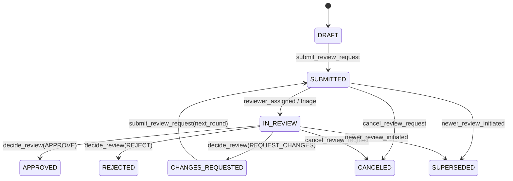

# Stage 108: Institutional Research Collaboration, Analyst Review, Evidence Governance and Approval Workflow Platform

## Executive Summary
Stage 108 of the ATLAS engineering roadmap delivers an institutional-grade research operations, collaboration, evidence governance, and formal review system. Building directly upon Stage 104 (Research Investigations, Notes, Hypotheses, Claims, Evidence & Citations), Stage 105 (Document Intelligence & Search), Stage 106 (Reproducible Analysis Workbench), and Stage 107 (Investment Thesis & Report Studio), Stage 108 introduces the controlled human review and approval workflows required for multi-analyst research teams and compliance-certified internal publication.

```
       RESEARCH INVESTIGATION (Stage 104)
                    |
                    v
         SOURCE DISCOVERY (Stage 105)
                    |
                    v
        DOCUMENT EVIDENCE (Stage 105)
                    |
                    v
       FINANCIAL ANALYSIS (Stage 106)
                    |
                    v
        RESEARCH FINDINGS (Stage 106)
                    |
                    v
       INVESTMENT THESIS (Stage 107)
                    |
                    v
        RESEARCH REPORT (Stage 107)
                    |
                    v
┌───────────────────────────────────────────────┐
│       STAGE 108 COLLABORATION & GOVERNANCE    │
│  - Participant Governance & Access Grants     │
│  - Formal Review State Machine & Revisions    │
│  - Exact Revision Binding & Content Hashes    │
│  - Separation of Duties (No Self-Approval)    │
│  - Anchored Comment Threads & Staleness       │
│  - Automated Quality Gates (Blocking/Warning) │
│  - Controlled Internal Circulation Lists      │
│  - Comprehensive Audit Trail & Event Logging  │
└───────────────────────────────────────────────┘
```

---

## Architecture & Core Modules

### 1. Participant Governance & Access Grants
Access control for research assets (`INVESTIGATION`, `REPORT`, `THESIS`) is managed via granular, auditable grants (`ResearchAccessGrant`).

#### Hierarchical Role System
| Role | Capabilities |
|---|---|
| `OWNER` | Full administrative control, participant grant/revocation, document editing, report finalization, and circulation management. |
| `EDITOR` | Content creation, section editing, revision creation, and analysis execution. Cannot modify participants or self-approve reviews. |
| `REVIEWER` | Inspect research, create anchored critique comments, run quality gates, and issue formal review decisions (`APPROVE`, `REQUEST_CHANGES`, `REJECT`). |
| `COMMENTER` | Read-only access to document contents with permission to add and reply to anchored comment threads. |
| `VIEWER` | Read-only access for compliance, audit, and observational review. |

#### Principal Polymorphism & Expirations
Grants support both individual analysts (`USER`) and institutional desks (`TEAM` / `GROUP`), with optional ISO 8601 expirations (`expires_at`) and audit-traceable revocation timestamps (`revoked_at`).

---

### 2. Research Review State Machine
The formal review workflow ensures that research reports and investment theses cannot be distributed without structured peer scrutiny and compliance validation.



#### Exact Revision Binding & Anti-Tampering Concurrency
- When a review request is submitted, it binds strictly to the `target_revision_number` and its SHA-256 `target_content_hash`.
- If an author mutates the document while a review is pending, creating a higher revision, subsequent review decisions fail with `ResearchReviewRevisionMismatchError` (HTTP 400).
- This guarantees that approvals certify only the exact text, tables, and citations inspected by the reviewer.

#### Separation of Duties Enforcement
To maintain institutional integrity and comply with research governance standards:
- **No Author Self-Approval**: A report author or owner cannot issue an `APPROVE` decision on their own research.
- Violations raise `ResearchReviewSelfApprovalForbiddenError` (HTTP 403 Forbidden).

---

### 3. Anchored Discussion Threads & Staleness Tracking
Commentary is not stored as freeform unstructured text; it is strictly anchored to underlying research artifacts.

#### Anchor Taxonomy
- `REPORT_SECTION`: Specific numbered or unnumbered document section.
- `CONTENT_BLOCK`: Individual paragraph, table, or chart embed.
- `TEXT_RANGE`: Exact highlight quotation or line range.
- `CITATION`: Filing citation or external source reference.
- `ANALYSIS_RUN`: Reproducible calculation or peer benchmark execution.
- `FINDING`: Empirical finding or evaluated hypothesis.

#### Revision Staleness
Threads record the document revision active at the time of authoring (`target_revision_number`). When subsequent document revisions are generated, threads evaluate `is_stale: bool`. Stale threads are badged in the UI to notify reviewers that the underlying referenced text or data may have changed.

#### Resolution Lifecycle
Threads follow an explicit resolution lifecycle (`OPEN` -> `RESOLVED` <-> `REOPENED`), capturing the resolver's identity (`resolved_by`) and timestamp (`resolved_at`).

---

### 4. Governance Quality Gates Engine
The automated quality gate engine (`run_quality_gate`) acts as an automated compliance and quality barrier before a report can be finalized or circulated.

#### Evaluation Rules
1. **Structural Completeness**: Verifies mandatory sections (Executive Summary, Financial Analysis, Risks, Methodology, Disclaimers).
2. **Comment Audit**: Detects unresolved open comment threads and flags them as blocking or warning issues.
3. **Citation & Evidence Integrity**: Verifies that all citations link to valid, active source references.
4. **Content Cleanness**: Scans for placeholder draft markers (`TODO`, `TBD`, `DRAFT DRAFT`).
5. **Formal Approval Verification**: Verifies whether the revision holds an active, valid `APPROVED` review decision.

#### Output Classification
- `BLOCKING`: Hard failures preventing report circulation (`can_circulate: false`).
- `WARNING`: Advisory notices highlighting non-fatal gaps.
- `CHECKS_PASSED`: Explicit checklist of validated institutional criteria.

---

### 5. Controlled Internal Circulation
Circulation permits reviewed and approved reports to be shared securely with internal departments and stakeholder lists.

#### Circulation Rules
- **Approval Prerequisite**: Attempting to circulate a report that is not in `APPROVED` or `FINALIZED` status raises `ResearchCirculationForbiddenError` (HTTP 400).
- **Recipient Restrictions**: Access can be limited to specified users (`authorized_recipient_ids`) or internal teams (`authorized_team_ids`).
- **Watermarking & Confidentiality**: Circulation manifests specify restriction notices and distribution boundaries.
- **Revocation**: Circulations can be revoked immediately, terminating recipient access and logging the revocation timestamp.

---

### 6. Operations Audit Trail
Every critical mutation in the collaboration lifecycle generates an immutable `ResearchAuditEvent`:
- `GRANT_CREATED`, `GRANT_UPDATED`, `GRANT_REVOKED`
- `REVIEW_SUBMITTED`, `REVIEW_DECIDED`
- `COMMENT_ADDED`, `COMMENT_RESOLVED`, `COMMENT_REOPENED`
- `QUALITY_GATE_RUN`
- `REPORT_CIRCULATED`, `CIRCULATION_REVOKED`

---

## Frontend Research Review Studio (`/research`)

Integrated into `/research` via the `"Reviews & Governance"` tab:
1. **`ResearchReviewQueue`**: Filterable list of review requests (by status, scope, priority, and date).
2. **`ResearchReviewDetail`**: Detailed review workspace showing target report metadata, assigned reviewers, instructions, round index, quality gate summary, and reviewer decision controls (`APPROVE`, `REQUEST_CHANGES`, `REJECT`).
3. **`ResearchCommentSidebar`**: Anchored discussion panel supporting new anchored threads, inline replies, resolution toggles, and staleness badges.
4. **`ResearchParticipantsModal`**: Modal dialog for managing research collaborators, changing roles, and revoking grants.
5. **`ResearchCirculationDialog`**: Modal dialog for configuring internal distribution lists and auditing active circulations.
6. **`NewReviewDialog`**: Dialog for submitting a report or thesis for formal peer review.

---

## Verification & Testing
- **Backend Unit & Integration Tests**: `apps/api/tests/test_research_collaboration_and_review_v1.py` (9 tests covering grants, reviews, self-approval guards, revision mismatch guards, comments, quality gates, and circulation). All **68 research tests pass**.
- **Frontend Test Suite**: `apps/web/src/lib/research/__tests__/research_reviews.test.ts` (covering formatters, status mappers, and role representations). All **93 frontend tests pass**.
- **TypeScript & Linting**: `tsc --noEmit` and `eslint` pass with **0 errors**.
- **Next.js Production Build**: Turbopack build succeeds with **0 errors** across all 38 static and dynamic application routes.

