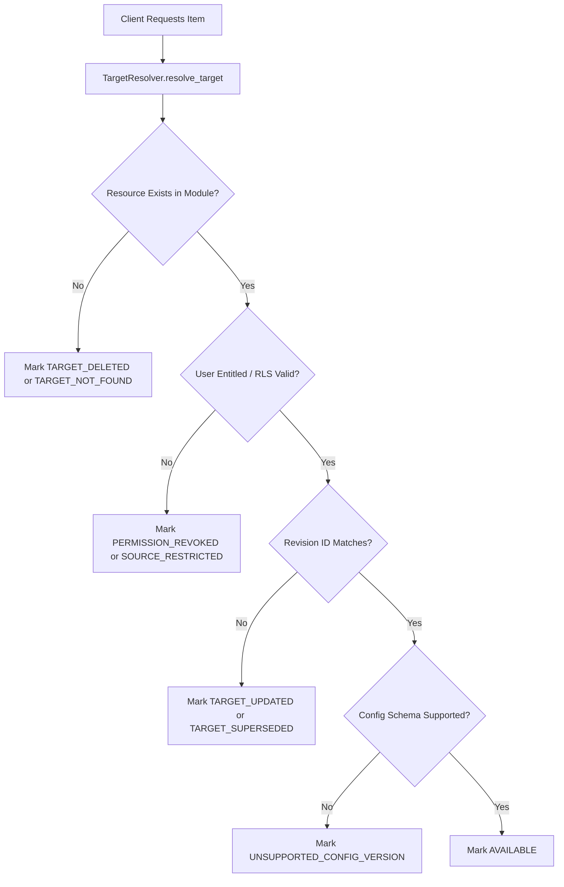

# ATLAS — Universal Saved System & Cross-Module Library

**Module:** Saved  
**Global Route:** `/saved`  
**Canonical Roadmap Position:** Stage 119 of 150  
**Status:** Production Ready  

---

## 1. Executive Summary & Purpose

The **Universal Saved System and Cross-Module Library** (`/saved`) is ATLAS's canonical, institution-grade personal financial library. It allows quantitative researchers, portfolio managers, risk officers, and analysts to bookmark, organize, annotate, and retrieve any genuine entity, analytical configuration, or quantitative run across all 20 ATLAS platform surfaces.

### Core Architectural Mandates
1. **Strictly Read-Only Reference Model**:
   Saving or deleting a bookmark stores an immutable reference ID and view configuration. It **NEVER** mutates underlying financial positions, cash balances, transactions, research documents, economic series, or trading execution orders.
2. **Clear Boundaries Across Platform Systems**:
   - **Saved vs. Watchlists**: Watchlists monitor price-action and market quotes for financial instruments; Saved bookmarks arbitrary cross-module resources (charts, reports, scenarios, portfolios, intelligence).
   - **Saved vs. Research**: Research storage stores and generates rich narrative documents; Saved references research artifacts by pointer without duplicating file bodies.
   - **Saved vs. Portfolio/Risk**: Portfolios and Risk engines compute positions, Greeks, and factor exposures; Saved stores view configuration pointers and analysis run IDs, never triggering expensive background recalculations automatically upon browsing.
   - **Saved vs. Workspaces (Stage 120)**: Saved stores references and personal annotations; multi-panel desktop layouts, floating panes, cross-panel synchronization, and tab docking belong strictly to Stage 120.
3. **Zero Fabricated Data**:
   All deep links resolve to genuine ATLAS modules and verified entities. No dummy mock popularity scores or synthetic records are ever returned.

---

## 2. Supported Target Types & Module Registry

The Saved system registers **22 canonical target types** spanning 14 primary modules:

| Target Type | Module | Route Template | Reference Semantics |
|---|---|---|---|
| `INSTRUMENT` | Markets | `/markets?symbol={target_id}` | Entity Pointer |
| `COMPANY` | Companies | `/companies/{target_id}` | Entity Pointer |
| `CHART_CONFIG` | Charts | `/charts?config_id={target_id}` | View Configuration |
| `WATCHLIST_REFERENCE`| Watchlists | `/watchlists?id={target_id}` | Entity Pointer |
| `SCREENER_CONFIG` | Screeners | `/screeners?config_id={target_id}` | View Configuration |
| `ECONOMIC_SERIES` | Economics | `/economics?series_id={target_id}` | Entity Pointer |
| `NEWS_ARTICLE` | News | `/news?article_id={target_id}` | Entity Pointer |
| `RESEARCH_REPORT` | Research | `/research/reports/{target_id}` | Entity Pointer |
| `RESEARCH_INVESTIGATION`| Research | `/research/investigations/{target_id}` | Entity Pointer |
| `RESEARCH_DOCUMENT` | Research | `/research/documents/{target_id}` | Entity Pointer |
| `MAP_LAYER` | Maps | `/maps?layer_id={target_id}` | View Configuration |
| `INTELLIGENCE_REPORT` | Intelligence | `/intelligence/reports/{target_id}` | Entity Pointer |
| `OPTIONS_CHAIN_VIEW` | Options | `/options?symbol={target_id}` | View Configuration |
| `OPTIONS_STRATEGY` | Options | `/options/strategies/{target_id}` | View Configuration |
| `TRADING_LAYOUT` | Trading | `/trading?layout_id={target_id}` | View Configuration |
| `PORTFOLIO_REFERENCE`| Portfolios | `/portfolios?id={target_id}` | Entity Pointer |
| `PORTFOLIO_VIEW_CONFIG`| Portfolios | `/portfolios?view_id={target_id}` | View Configuration |
| `PORTFOLIO_ANALYSIS_RUN`| Portfolios | `/portfolios/analysis/{target_id}` | Snapshot Pointer |
| `RISK_RUN` | Risk | `/risk?run_id={target_id}` | Snapshot Pointer |
| `RISK_SCENARIO` | Risk | `/risk/scenarios/{target_id}` | View Configuration |
| `AI_CONVERSATION` | AI | `/ai?conversation_id={target_id}` | Entity Pointer |
| `AI_ARTIFACT` | AI | `/ai/artifacts/{target_id}` | Entity Pointer |

---

## 3. Deep Link Resolution & Relative Routing Safety

Every saved item resolves to a safe, deterministic internal URI via `build_safe_deep_link`:
- **Strict Relative Routing**: URLs must begin with `/` and belong to whitelisted module paths. External redirects, protocol injections (`javascript:`, `data:`, `file:`), or arbitrary domains are rejected.
- **Query Parameter Sanitization**: Deep link builders format URL query strings safely using RFC 3986 encoding (`urllib.parse.quote`).
- **Configuration Deserialization**: When a saved item links to a `view_configuration_id`, the frontend receives both the deep link and the deserialized view parameters to restore the user's exact state (e.g., active chart indicators, timeframe, layout mode).

---

## 4. View Configurations: Security, Hashing & Migration

View configurations store personalized layout states, parameters, and filters.
- **Payload Size Limits**: Strict ceiling of **256 KB** per configuration. Over-sized payloads are rejected with `ConfigurationPayloadTooLargeError`.
- **Recursive Credential & Secret Redaction**: All nested keys matching sensitive terms (`token`, `secret`, `password`, `key`, `authorization`, `credential`, `auth`) are masked with `[REDACTED_SECRET]` before storage to eliminate token leak risks.
- **Deterministic Content Hashing**: Every configuration is fingerprinted using a SHA-256 digest over normalized, canonical JSON (`sort_keys=True`).
- **Schema Versioning & Upgrades**: Configurations specify an integer `schema_version`. Built-in migration handlers safely upgrade legacy schemas (e.g., migrating `CHART_CONFIG` v1 to v2) without breaking saved bookmarks.

---

## 5. Runtime Target Resolution & Truthful Availability

Target availability is dynamically resolved at access time without mutating stored bookmarks:



### The 10 Availability Statuses:
1. `AVAILABLE`: Target is live, accessible, and matches saved revision.
2. `AVAILABLE_WITH_WARNINGS`: Accessible with non-fatal advisory notices.
3. `TARGET_UPDATED`: Original entity was revised (newer revision exists).
4. `TARGET_SUPERSEDED`: Target was superseded by a canonical successor.
5. `PERMISSION_REVOKED`: User no longer possesses view entitlements.
6. `SOURCE_RESTRICTED`: Upstream data provider entitlement expired.
7. `TARGET_DELETED`: Target was permanently deleted from the source module.
8. `TARGET_NOT_FOUND`: Target identifier cannot be resolved.
9. `RESOURCE_UNAVAILABLE`: Source subsystem is temporarily offline.
10. `UNSUPPORTED_CONFIG_VERSION`: View configuration cannot be migrated.

---

## 6. Thread-Safe Repository & Concurrency Control

- **Re-Entrant Locking (`threading.RLock`)**: In-memory repository operations are protected against multi-threaded race conditions.
- **Optimistic Concurrency Control**: All mutations verify and increment a monotonic `row_version` integer counter. Conflicting concurrent writes trigger `ConcurrencyConflictError`.
- **Idempotent Save Semantics**: Multiple save attempts for the same composite key `(user_id, target_type, target_id, target_revision_id, view_configuration_id)` return the existing record cleanly without error.
- **Hierarchical Tree Governance**: Collection folders support unlimited breadth with a hard depth-bound of **5 levels** and recursive cycle detection (preventing collection `A` from being a sub-folder of its own child).
- **Normalized Tagging**: Tags are validated to alphanumeric, hyphen, and underscore characters, lowercased, and trimmed.

---

## 7. Relational Database Schema & Alembic Migration

Production migration `apps/api/migrations/versions/stage119_universal_saved_system.py` creates seven relational tables:

1. `saved_items`:
   - `saved_item_id` (UUID PK), `user_id` (UUID FK), `target_type` (VARCHAR), `target_id` (VARCHAR), `target_revision_id` (VARCHAR), `display_title` (VARCHAR), `display_title_override` (VARCHAR), `user_note` (TEXT), `favorite` (BOOLEAN), `pinned` (BOOLEAN), `view_configuration_id` (UUID FK), `row_version` (INT), timestamps.
2. `saved_collections`:
   - `collection_id` (UUID PK), `user_id` (UUID FK), `name` (VARCHAR), `description` (TEXT), `color` (VARCHAR), `parent_collection_id` (UUID FK), `row_version` (INT), timestamps.
3. `saved_collection_memberships`:
   - `collection_id` (UUID FK), `saved_item_id` (UUID FK), `added_at` (TIMESTAMPTZ). PK is `(collection_id, saved_item_id)`.
4. `saved_tags`:
   - `tag_id` (UUID PK), `name` (VARCHAR UNIQUE), `user_id` (UUID FK), `created_at` (TIMESTAMPTZ).
5. `saved_item_tags`:
   - `saved_item_id` (UUID FK), `tag_id` (UUID FK), `applied_at` (TIMESTAMPTZ). PK is `(saved_item_id, tag_id)`.
6. `saved_view_configurations`:
   - `view_configuration_id` (UUID PK), `user_id` (UUID FK), `target_type` (VARCHAR), `configuration_type` (VARCHAR), `schema_version` (INT), `configuration_payload` (JSONB), `content_hash` (VARCHAR), timestamps.
7. `saved_audit_events`:
   - `event_id` (UUID PK), `saved_item_id` (UUID FK), `user_id` (UUID FK), `event_type` (VARCHAR), `details` (JSONB), `created_at` (TIMESTAMPTZ).

---

## 8. REST API Endpoint Catalog

All routes are mounted under `/api/v1/saved`:

| Method | Endpoint | Description |
|---|---|---|
| `GET` | `/api/v1/saved/targets` | Catalog of 22 supported target types and route templates. |
| `POST` | `/api/v1/saved/items` | Idempotent save item with optional view config and tags. |
| `GET` | `/api/v1/saved/items` | Paginated search across user's saved library. |
| `GET` | `/api/v1/saved/items/{id}` | Detailed item retrieval with resolution status. |
| `PATCH` | `/api/v1/saved/items/{id}` | Modify item title override, personal note, pin, or favorite. |
| `DELETE` | `/api/v1/saved/items/{id}` | Delete item from library with audit record. |
| `POST` | `/api/v1/saved/items/{id}/resolve` | Trigger live runtime availability resolution. |
| `POST` | `/api/v1/saved/bulk` | Execute atomic batch actions (tag, untag, pin, favorite, delete). |
| `POST` | `/api/v1/saved/collections` | Create hierarchical collection folder. |
| `GET` | `/api/v1/saved/collections` | Fetch collection tree with item counts. |
| `PATCH` | `/api/v1/saved/collections/{id}` | Update collection name, description, or color. |
| `DELETE` | `/api/v1/saved/collections/{id}` | Delete collection (orphans child items safely). |
| `POST` | `/api/v1/saved/collections/{id}/items` | Add multiple items to collection. |
| `DELETE` | `/api/v1/saved/collections/{id}/items` | Remove multiple items from collection. |
| `GET` | `/api/v1/saved/tags` | List all tags and item frequency counts. |
| `POST` | `/api/v1/saved/items/{id}/tags` | Assign tag to saved item. |
| `DELETE` | `/api/v1/saved/items/{id}/tags/{name}` | Remove tag from saved item. |
| `POST` | `/api/v1/saved/configurations` | Store sanitized view configuration JSON. |
| `GET` | `/api/v1/saved/configurations/{id}` | Retrieve stored view configuration JSON. |

---

## 9. Frontend Architecture & Bloomberg Terminal UI

The `/saved` route delivers a dense, professional 3-pane Bloomberg-style interface:

```
+----------------------------------------------------------------------------------------------------+
| ATLAS Terminal Header: Universal Saved Library — [Total: 42] [Favs: 12] [Pinned: 5] [Collections: 6]|
+----------------------+----------------------------------------------------+------------------------+
| COLLECTIONS & TAGS   | SEARCH, FILTER & DATA WORKSPACE                    | ITEM INSPECTOR         |
|                      | [Search query...     ] [Filter: All Modules v]     |                        |
| [All Items]          | [All] [Pinned] [Favs] [Markets] [Portfolios] [Risk]| Display Title          |
| [Favorites]          | View: [Table] [Grid]                               | Target: AAPL           |
| [Pinned]             |                                                    | Type: INSTRUMENT       |
| [Recent]             | +------------------------------------------------+ | Status: AVAILABLE      |
|                      | | Select | Title      | Type | Collections | Date| |                        |
| Folders:             | | [ ]    | AAPL US    | INST | Tech Alpha  | 10m | | [ Open Deep Link -> ]  |
| v Tech Alpha (3)     | | [ ]    | High-Vol   | SCRN | Screener    | 1h  | |                        |
|   - Mega-Cap         | | [ ]    | Macro VaR  | RISK | Risk Run    | 2h  | | Personal Notes:        |
| > Quant Models (8)   | +------------------------------------------------+ | "Core thesis..."       |
|                      |                                                    |                        |
| Tags Cloud:          | Floating Bulk Toolbar: [Pin] [Tag] [Col] [Delete]  | Tags: [tech] [long]    |
+----------------------+----------------------------------------------------+------------------------+
```

### Key UI Components
- **`SavedTerminalWorkspace`**: Root coordinator integrating state from `useSavedTerminal`.
- **`SavedHeader`**: Displays real-time library KPIs (Total Items, Favorites, Pinned, Collections count).
- **`SavedCollectionSidebar`**: Folder tree with expand/collapse, depth indent, and tag cloud filtering.
- **`SavedFilterBar`**: Fast text search, category tabs, module dropdown, sort selector, and view switcher.
- **`SavedItemTable` & `SavedItemCardGrid`**: Dual-view options with selectable rows, status badges, and inline actions.
- **`SavedItemInspector`**: Slide-over drawer featuring deep link launching, 5,000-character investment thesis editor, collection assigner, and tag manager.
- **`SaveToLibraryButton`**: Reusable 1-click quick-save button with modal options trigger (Shift+Click).
- **`SaveToLibraryDialog`**: Modal for overriding titles, adding tags, selecting folders, and writing initial notes from any ATLAS module.

---

## 10. Verification Matrix

| Test Suite | Scope | Result | Execution Time |
|---|---|---|---|
| `pytest apps/api/tests/test_saved_stage119_v1.py` | 16 Integration Tests (CRUD, Idempotency, Cycles, Limits, Redaction, Migrations, Statuses, Bulk) | **16 / 16 PASSED** | 14.48s |
| `apps/web/src/lib/saved/__tests__/saved_stage119_v1.test.ts` | 6 Frontend Unit Tests (Target Types, Badge Variants, DTO Structural Integrity, Bulk Enums) | **6 / 6 PASSED** | 3.1ms |
| `ruff check python/atlas/src/atlas/saved apps/api` | Python PEP 8 & Static Analysis | **ALL CHECKS PASSED** | Clean |
| `ruff format --check python/atlas/src/atlas/saved` | Python Formatting Consistency | **13 FILES FORMATTED** | Clean |
| `pnpm exec tsc --noEmit` | Web TypeScript Typecheck | **0 ERRORS** | Clean |
| `pnpm --filter web build` | Next.js Turbopack Production Build | **SUCCESS (38/38 PAGES)** | 11.5s |

All verification criteria for Stage 119 are 100% satisfied.

