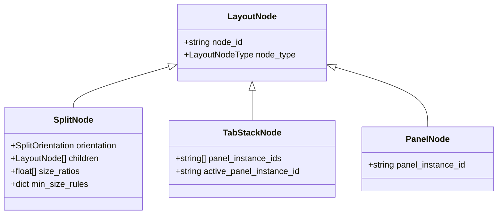
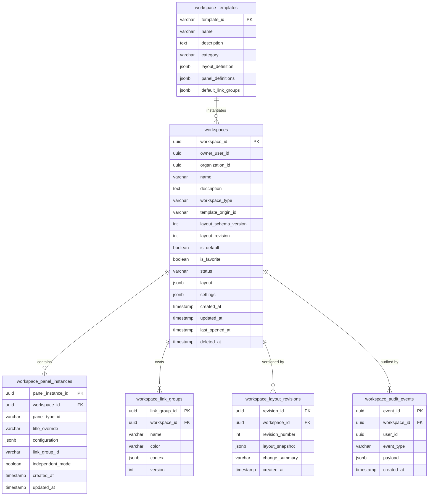

# ATLAS Multi-Panel Financial Workspaces Architecture (Stage 120)

## Executive Summary

ATLAS Stage 120 transforms the platform from a collection of standalone analytical modules into a unified, institutional-grade multi-panel financial desktop (`/workspaces`). Inspired by professional Bloomberg Terminal, FactSet, and TradingView multi-window workstations, ATLAS Workspaces provides dockable windowing, recursive horizontal and vertical splits, tabbed stacks, cross-panel context synchronization, optimistic concurrency control, and persistent layout serialization.

---

## 1. Core Architectural Principles

1. **Analytical Orchestration, Not Data Replication**: The Workspace subsystem is an orchestration and windowing layer. It hosts and coordinates live financial modules (Markets, Charts, Watchlists, Portfolios, Risk, News, Economics, Companies, and Saved Resources) without duplicating their underlying databases or modifying financial accounting state.
2. **Deterministic Layout Trees**: Desktop layouts are modeled as strict, cycle-free recursive trees composed of `SplitNode` (horizontal or vertical partitions with normalized size ratios), `TabStackNode` (stacked panels sharing a frame), and `PanelNode` (leaf nodes pointing to live panel instances).
3. **Optimistic Concurrency Control**: Desks feature monotonic `layout_revision` integer counters. Concurrent browser tabs or multi-device sessions detecting an outdated revision are rejected with `409 Conflict`, prompting the user to reload external changes or overwrite safely.
4. **Resilient Self-Healing Fault Recovery**: If a serialized layout tree fails schema validation or exceeds safety thresholds (max depth 8, max panels 24, ratio sums deviating from 1.0), the engine invokes `create_safe_recovery_layout()` to preserve all active panel instances in a clean, recoverable split without dropping user analytical context.
5. **Cross-Panel Context Dimensions**: Panels can be linked to color-coded Link Groups (e.g., Group A Blue, Group B Green). Modifying a ticker, company, portfolio, or date range in any member panel instantly synchronizes all linked panels across the desk with built-in event-loop suppression.

---

## 2. Layout Engine & Tree Specification

### 2.1 Node Hierarchy

- **`SplitNode`**: Represents a container divided along a horizontal or vertical axis (`SplitOrientation.HORIZONTAL` or `SplitOrientation.VERTICAL`). Contains `children: LayoutNode[]` and `size_ratios: float[]`. The layout validator verifies that all ratios are strictly positive and sum to `1.0 ± 1e-4`.
- **`TabStackNode`**: Represents a composite frame holding multiple panels tabbed together, where only one is active at a time (`active_panel_instance_id`).
- **`PanelNode`**: Terminal leaf node referencing a `panel_instance_id`.

### 2.2 Invariant Validation Rules

The `LayoutValidator` enforces the following constraints prior to saving or rendering:
- **Maximum Tree Depth**: Depth $\le 8$ levels to prevent recursive stack overflows.
- **Maximum Panel Count**: Maximum 24 panel instances per desk to ensure sub-100ms render latency.
- **Ratio Normalization**: All split children ratios must sum to 1.0. Floating-point drift is automatically normalized.
- **No Orphaned or Dangling Panels**: Every `panel_instance_id` referenced in the layout tree must exist in the workspace's `panel_instances` registry, and every active panel instance must be represented in the tree.
- **Zero Cycle Invariant**: Circular tree references are detected and rejected.

---

## 3. Cross-Panel Context Engine

### 3.1 Link Groups & Financial Dimensions

Panels synchronize through `WorkspaceLinkGroup` definitions. Each workspace supports multiple active link channels:

| Group Name | Badge Color | Default Role |
| :--- | :--- | :--- |
| **Group A** | `#3B82F6` (Blue) | Core Equity & Technical Research |
| **Group B** | `#10B981` (Green) | Macro & Fixed Income Correlation |
| **Group C** | `#F59E0B` (Amber) | Derivatives & Volatility Analytics |
| **Group D** | `#F43F5E` (Rose) | Portfolio & Risk Management |

### 3.2 Canonical Context Dimensions

The context bus coordinates eight standard financial dimensions:
1. `INSTRUMENT`: Canonical ticker symbol (e.g., `AAPL`, `MSFT`, `SPY`).
2. `COMPANY`: Corporate entity or issuer name.
3. `PORTFOLIO`: Target portfolio ID.
4. `BENCHMARK`: Benchmark reference index (e.g., `SPX`, `NDX`).
5. `DATE_RANGE`: Global start and end analysis dates.
6. `AS_OF_DATE`: Point-in-time calculation snapshot.
7. `TIMEFRAME`: Intraday or historical interval (e.g., `1D`, `1W`, `1M`, `1Y`).
8. `REPORTING_CURRENCY`: Base currency for valuations (e.g., `USD`, `EUR`, `GBP`).

### 3.3 Event Loop Prevention & Independent Mode

- **Event Loop Suppression**: Each context update increments a monotonic link group `version` counter and propagates the originating `caller_panel_id`. Member panels ignore broadcasts originating from themselves or older version snapshots.
- **Independent Mode**: Panels can toggle `independent_mode = true` or `link_group_id = null` to detach from global broadcasts, allowing fixed watchlists or pinned macro charts to remain static while surrounding panels respond to ticker clicks.

---

## 4. Canonical Panel Types & Specialized Adapters

The system provides 14 canonical registered panel types, each backed by real financial modules and resilient error boundaries:

| Panel Type ID | Canonical Title | Module Source | Accepts Context | Emits Context |
| :--- | :--- | :--- | :--- | :--- |
| `MARKET_OVERVIEW` | Global Markets | Markets (`/markets`) | Currencies | Instrument |
| `INSTRUMENT_CHART` | Interactive Chart | Charts (`/charts`) | Instrument, Timeframe | Instrument |
| `WATCHLIST` | Monitored Securities | Watchlists (`/watchlists`) | None | Instrument, Company |
| `SCREENER` | Quantitative Screener | Screeners (`/screeners`) | None | Instrument |
| `COMPANY_OVERVIEW` | Company Fundamentals | Companies (`/companies`) | Instrument, Company | Company |
| `ECONOMIC_SERIES` | Macro Indicators | Economics (`/economics`) | Date Range | Date Range |
| `NEWS_FEED` | Real-Time News Wire | News (`/news`) | Instrument, Company | None |
| `RESEARCH_DOCUMENT` | Document Reader | Research (`/research`) | Instrument | None |
| `RESEARCH_REPORT` | Institutional Report | Research (`/research`) | Instrument | None |
| `PORTFOLIO_SUMMARY` | Portfolio Holdings | Portfolios (`/portfolios`)| Portfolio | Instrument |
| `PORTFOLIO_PERFORMANCE`| Performance & Returns| Portfolios (`/portfolios`)| Portfolio, Date Range | None |
| `RISK_OVERVIEW` | Portfolio Risk Profile | Risk (`/risk`) | Portfolio | None |
| `RISK_ANALYSIS` | Factor & VaR Analytics| Risk (`/risk`) | Portfolio, Instrument | None |
| `DATA_TABLE` | Financial Data Explorer | Data (`/data`) | Instrument, Date Range | Instrument |

---

## 5. Institutional Workspace Templates

Six canonical pre-built desk configurations are available out of the box:

1. **`BLANK_DESK` (Blank Canvas)**: Single empty panel allowing freeform multi-panel composition.
2. **`EQUITY_RESEARCH_DESK` (Equity Research Desk)**: 4 panels in balanced split — Watchlist, Technical Chart, Company Fundamentals, and Real-Time News Wire, pre-linked on Group A.
3. **`MARKET_MONITORING_DESK` (Market Monitoring Desk)**: 4 panels — Global Market Overview, Technical Chart, Screener, and Real-Time News Wire.
4. **`MACRO_DESK` (Global Macro Desk)**: 4 panels — Macro Economic Series, Central Bank Rates, Cross-Asset Market Overview, and Macro Intelligence Wire.
5. **`PORTFOLIO_DESK` (Portfolio Manager Desk)**: 3 panels — Portfolio Holdings Summary, Performance Attribution Chart, and Risk Overview Card.
6. **`RISK_DESK` (Chief Risk Officer Desk)**: 4 panels — Portfolio Risk Profile, Factor Sensitivities, Tail-Loss Distribution / VaR, and Options/Fixed-Income Sensitivities.

---

## 6. Relational Persistence Schema

The workspace engine is backed by six dedicated relational tables:

---

## 7. Stage 119 Universal Saved Library Integration

Workspaces interface cleanly with Stage 119 (`/saved`):
- Panels can embed saved view configurations (`saved_view_configurations`) using `configuration.saved_view_config_id`.
- The Workspace Header includes an action to bookmark the entire desk to the Universal Saved Library as an analytical workspace reference.
- Panels verify target resolution status via `TargetResolver` and display non-blocking warnings if an underlying portfolio or chart configuration is superseded or deleted.

---

## 8. Verification & Test Metrics

- **Backend Pytest Suite**: 17 domain and integration tests passed in 7.71s (`apps/api/tests/test_workspaces_stage120_v1.py`).
- **Frontend Unit Tests**: 11 unit tests passed in 891ms (`apps/web/src/lib/workspaces/__tests__/workspaces_stage120_v1.test.ts`).
- **Static Type Analysis**: 0 errors across backend (`ruff check`, `ruff format`) and frontend (`tsc --noEmit`).
- **Production Build**: Clean compilation across all 38 Next.js pages including `/workspaces`.

